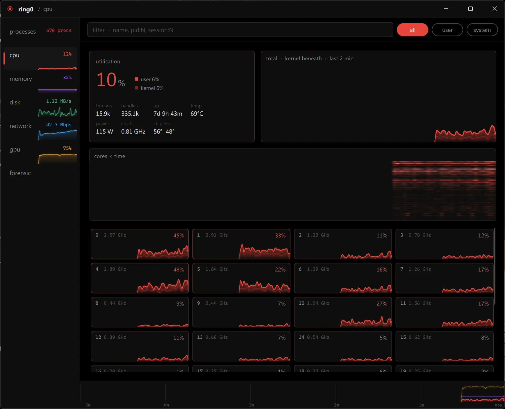

# ring0

**A task manager that shows what the machine is actually doing, drawn on the GPU.**

---

Seven views: processes, cpu, memory, disk, network, gpu, forensic. Every graph is a
scene-graph node with its own shaders; history scrolls at one constant speed, keyed
to sample timestamps rather than to when a sample happened to arrive.

## What it reads

- **Processes**: CPU, memory, disk and network per process (network and disk through
  a kernel ETW session), GPU utilisation and VRAM, signature status, icons.
- **CPU**: per-core load split user/kernel, a cores-by-time heat map, effective clock
  per core, package power, package and per-chiplet temperature.
- **Memory**: in use, modified, standby and free from the memory manager's own page
  lists, so the composition never double counts; DDR5 module temperatures.
- **Disk**: throughput, active time, drive temperature, mounted volumes, free space.
- **Network**: per adapter in bits per second, against link speed.
- **GPU**: utilisation per engine, adapter-wide VRAM, top processes by utilisation or
  by VRAM.
- **Forensic**: one process in depth. Identity, integrity, parent chain, loaded
  modules with signers, sockets, folded thread stacks, and plain findings (unsigned
  images or modules, binaries in user-writable folders, system binaries with the
  wrong parent).

CPU power, clocks and chiplet temperatures, and DDR5 temperatures, are read through
[PawnIO](https://pawnio.eu), a signed open-source driver. The installer offers it.
Without it those fields are absent and everything else works.

## Requirements

- Windows 11 24H2 (build 26100) or later, x64.
- sudo for Windows enabled in Inline mode. ring0 needs administrator rights for the
  kernel trace session and for other users' processes, and elevates itself through
  sudo rather than a manifest. If sudo is off, it says so and gives the fix:

      sudo config --enable normal

## Install

Download the installer from [releases](https://github.com/Locke-Werks/ring0/releases).
It checks the OS build and sudo before installing anything.

## Build

Visual Studio 2022 (MSVC 14.44+), CMake 3.28+, Ninja, Qt 6.11 for msvc2022_64.

    cmake --preset msvc-release
    cmake --build --preset msvc-release
    cmake --install out/msvc-release --prefix dist

`CMakePresets.json` expects Qt at `C:\Qt\6.11.3\msvc2022_64`.

Set `RING0_ALLOW_UNELEVATED=1` to run without elevating while developing; sensors
that need admin are then empty.

## License

GPL-3.0-or-later. The bundled PawnIO modules in `assets/pawnio` are LGPL-2.1, see
`assets/pawnio/COPYING`.
